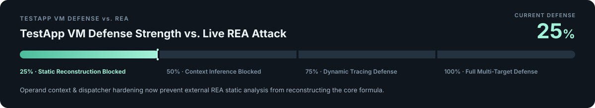
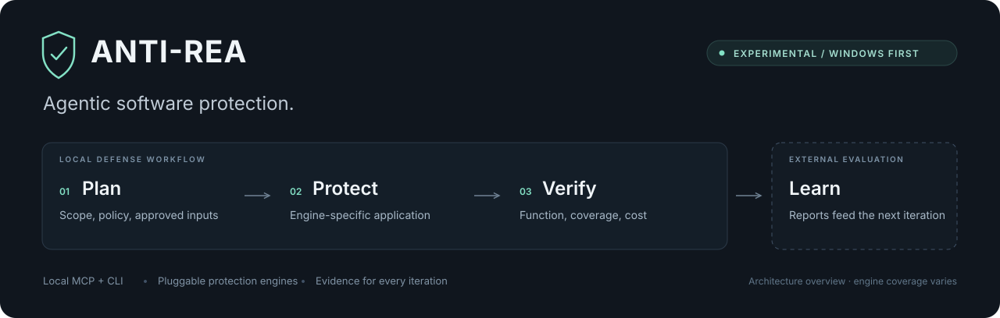

[English](README_en.md) · [简体中文](README_zh.md) · [繁體中文](README_zh-TW.md) · [日本語](README_ja.md) · [한국어](../../README.md) · **Türkçe** · [Русский](README_ru.md) · [Tiếng Việt](README_vi.md) · [ไทย](README_th.md) · [Deutsch](README_de.md) · [Español](README_es.md) · [Français](README_fr.md) · [Українська](README_uk.md) · [Polski](README_pl.md) · [Português (Brasil)](README_pt-BR.md) · [العربية](README_ar.md) · [فارسی](README_fa.md) · [Bahasa Indonesia](README_id.md) · [Italiano](README_it.md) · [Ελληνικά](README_el.md) · [മലയാളം](README_ml.md)

# ANTI-REA

### İkili dosyaları, uygulamaları ve çekirdek mantığı REA analizinden koruyan tek bir MCP.

**Korumak istediğiniz kritik bir özelliğiniz mi var? İkili (binary) seviyeye kadar analiz edilmesini ve kopyalanmasını engelleyin.**

[](#roadmap)
[](#quick-start)
[](#quick-start)
[](#engines)
[](../../LICENSE)

[REA](https://github.com/morluto/rea) gibi tersine mühendislik araçları, ajanınıza *"Şu uygulamadaki bu özelliğin nasıl çalıştığını analiz et ve projeme aynısını yap"* dediğinizde ikili dosyayı inceleyip orijinal mantığı birebir yeniden yazar.

**Ajantik saldırı mı? O halde bizim cevabımız ajantik savunma — zaman geçtikçe güçlenen savunma.** **ANTI-REA**'nın nihai hedefi, **REA'nın analiz edebildiği tüm hedefleri ve analiz yöntemlerini tamamen engellemektir**. Ajanınıza doğal dille **"Programımın çekirdek mantığını REA tarafından analiz edilip kopyalanmayacak şekilde koru"** demeniz yeterlidir; ajan çekirdek kodu ve çevredeki ipuçlarını bulur, karartma (obfuscation) ve sanallaştırma (VM) uygular, orijinal işlevin bozulmadığını doğrular ve çalışma hızının orijinalin yüzde kaçı olduğunu ölçer.

Karmaşık saldırı-savunma ortamlarını kendiniz kurmanıza gerek yoktur. **Her gün savunma bilgisayarımızı ayrı bir REA saldırı bilgisayarıyla karşı karşıya getiriyor, TestApp üzerindeki VM'in nereden delindiğini inceliyor ve zayıf noktaları kapatarak her geçen gün daha güçlü bir savunma inşa ediyoruz.** Siz sadece bu güçlendirilmiş ANTI-REA'yı kendi ajanınıza bağlayıp kullanırsınız.

---

## Mevcut Savunma Gücü ve Yol Haritası (TestApp VM vs. Gerçek REA Saldırısı)



Yukarıdaki değer soyut bir proje takvimi değil, **özel korumamızın uygulandığı TestApp'in ayrı bir bilgisayardaki doğrudan REA saldırılarına karşı ne kadar dayandığını (savunma gücünü)** gösterir.

### Savunma Güçlendirme Aşamaları (Nihai Hedef: REA'nın Analiz Ettiği Her Şeyi Engellemek)

- **%25 (Mevcut) · 1. Aşama Statik Çözümlemenin Engellenmesi:** İşleyici çeşitlendirme ve operand bağlam birleştirmesi ile harici REA statik analizinin çekirdek formülü tek seferde çözmesini engelledik.
- **%50 · Statik Analiz ve Çevresel Bağlam Çıkarımının Engellenmesi:** Dağıtıcı (dispatcher) içindeki yardımcı fonksiyonları ve çağrı grafiği ipuçlarını gizleyerek yalnızca statik derleme çözümüyle mantık yürütülmesini imkansız hale getirmek.
- **%75 · Dinamik İzleme ve Hata Ayıklama Savunması:** Saldırgan ajanlar hata ayıklayıcılar (debugger), Frida, çalışma izleri ve bellek dökümlerine başvurduğunda bile çekirdek mantığı ve sabitleri korumak.
- **%100 · REA'nın Analiz Ettiği Tüm Hedef ve Yollarda Tam Savunma:** Yalnızca yerel ikili dosyalar (C/C++, Rust, Go) değil; .NET, Java/Kotlin, JavaScript/Electron, Python ve macOS (Mach-O/ARM64) dahil REA'nın desteklediği tüm hedeflerde analizi engellemek.

---

## Hızlı Başlangıç

### 1. Kurulum ve Ajan Bağlantısı (`Set up your agent`)

Terminal komutları veya yapılandırma dosyalarıyla uğraşmanıza gerek yok. Ajanınıza (Claude Code, Cursor, Codex, Gemini CLI vb.) doğrudan şunu söyleyin:

```text
ANTI-REA'yı yerel bir Python sanal ortamına (.venv) kur ve hemen kullanabilmen için antirea.defense_mcp sunucusunu MCP'ye bağla.
```

### 2. Ajanınıza Doğal Dille Komut Verin (`Ask your agent`)

```text
Projemdeki çekirdek hesaplama mantığını ve çevresel ipuçlarını REA'nın analiz edip kopyalayamayacağı şekilde koru; orijinal işlevin bozulup bozulmadığını ve çalışma hızının orijinalin yüzde kaçı olduğunu bana söyle.
```

```text
app.exe için VMProtect ile önce bir koruma planı oluşturup bana göster, onayladığımda çalıştır.
```

### 3. Doğrudan Terminalden Kullanım (`Use the terminal`)

```powershell
.\.venv\Scripts\python.exe -m antirea.defense_mcp --config .runs/protectors.local.json providers
.\.venv\Scripts\python.exe -m antirea.defense_mcp --config .runs/protectors.local.json doctor
```

---

## Nasıl Çalışır ve Her Gün Nasıl Güçlenir?



| Iteration | Protection | REA Outcome |
|---|---|---|

---

## Desteklenen Motorlar

Yerleşik açık kaynak motoru (`Kagura + ANTI-REA`) her gün güçlenirken, **hemen şimdi daha güçlü bir korumaya ihtiyacınız varsa Themida, VMProtect veya Code Virtualizer'ı satın alıp bağlayabilir ve ANTI-REA üzerinden istediğiniz çalışma performansını ve savunma seviyesini ajanınıza doğal dille yazabilirsiniz.**

```text
Çalışma hızını orijinalin %80'inin üzerinde tutarken çekirdek mantığı mümkün olduğunca güçlü korumak için VMProtect (veya Themida / Code Virtualizer) kullan.
```

| Engine | Connection | Status |
|---|---|---|
| **Kagura + ANTI-REA** | C++/LLVM defense pipeline | Active VM protection, automated verification & daily hardening (Windows x86-64) |
| **Themida** | Defense MCP/CLI (`.tmd`/`.tm`) | Windows native x86/x64 PE adapter implemented |
| **VMProtect** | Defense MCP/CLI (`.vmp`) | Windows native x86/x64 PE adapter implemented |
| **Code Virtualizer** | Defense MCP/CLI (`.cv`) | Windows native x86/x64 PE adapter implemented |

---

## Geliştirme ve Test

```powershell
python -m unittest discover -s tests -v
```

Bu proje [MIT Lisansı](../../LICENSE) altında dağıtılmaktadır (bağlanan koruma motorları kendi lisanslarına tabidir).
